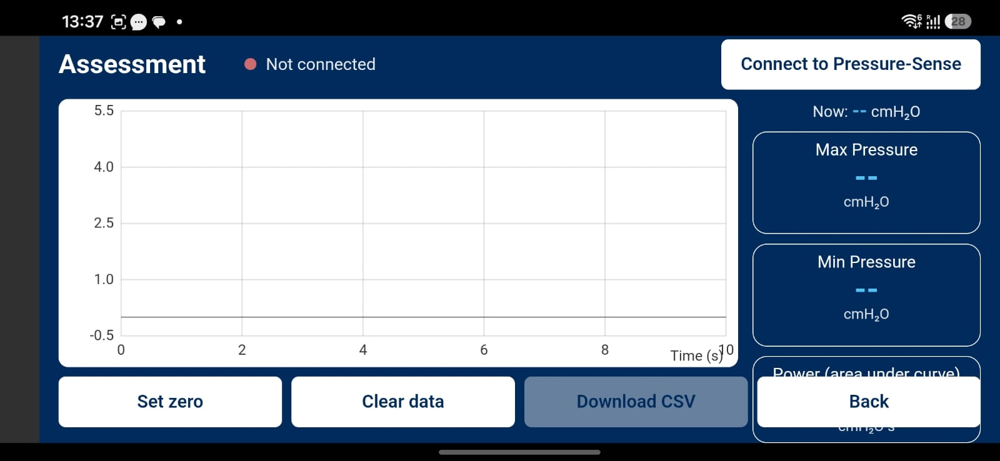
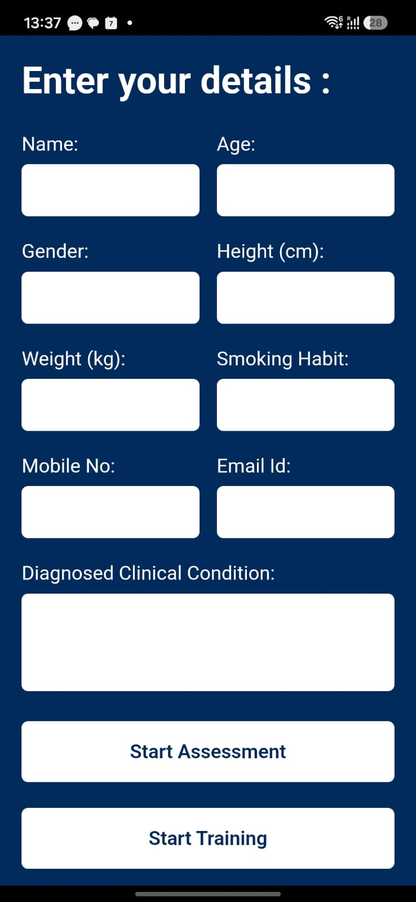

# Pulmoaid – ESP32-Based Respiratory Pressure Monitoring System

A wireless respiratory pressure monitoring prototype integrating an ESP32-S3, MPRLS pressure sensor, Bluetooth Low Energy (BLE), and a mobile application for real-time visualization and data logging.

## Overview

Pulmoaid is an embedded hardware and mobile application project designed to measure and visualize respiratory pressure measurements.

The system uses an MPRLS pressure sensor interfaced with a Seeed XIAO ESP32-S3. The microcontroller acquires pressure readings over I2C and transmits the measurements to a mobile application using Bluetooth Low Energy.

The application provides a live pressure graph, current pressure readings, maximum and minimum pressure tracking, and CSV data export for further analysis.

The prototype is intended for respiratory monitoring and research-oriented applications. It is not a certified medical diagnostic device.

## Key Features

### Embedded System
- ESP32-S3-based pressure monitoring.
- MPRLS pressure sensor integration.
- I2C communication.
- Custom BLE GATT service and characteristic.
- Periodic pressure acquisition.
- BLE notifications for connected devices.

### Mobile Application
- Wireless connection to the device.
- Real-time pressure visualization.
- Current pressure display.
- Maximum and minimum pressure tracking.
- Zero-setting functionality.
- Data clearing functionality.
- CSV data export.
- Assessment and training interfaces.

## Hardware Components

| Component | Function |
|---|---|
| Seeed XIAO ESP32-S3 | Main microcontroller |
| MPRLS pressure sensor | Pressure measurement |

## Technology Stack

**Embedded Firmware**
- C/C++
- Arduino Framework
- ESP32-S3
- I2C
- Adafruit MPRLS Library

**Wireless Communication**
- Bluetooth Low Energy
- BLE GATT
- Custom service and characteristic UUIDs

**Mobile Application**
- Capacitor
- Vite
- BLE communication
- Data visualization and CSV export

## System Architecture

```text
Respiratory Pressure Input
          |
          v
   MPRLS Pressure Sensor
          |
         I2C
          |
          v
    XIAO ESP32-S3
   Pressure Acquisition
          |
          v
   BLE GATT Service
          |
    BLE Notifications
          |
          v
     Mobile Application
          |
     +----+-----+
     |          |
     v          v
 Live Graph   Data Logging
     |          |
     v          v
 Min / Max    CSV Export
 Monitoring
```

## Mobile Application Screenshots

### Respiratory Pressure Assessment



The assessment interface displays live pressure measurements, pressure trends, maximum and minimum values, and data export controls.

### User Details Interface



The application includes a user details interface for assessment-related information.

## Operating Modes

Pulmoaid provides two operating modes that use the same pressure measurement and visualization pipeline while maintaining separate session records.

### 1. Assessment Mode
Designed for recording respiratory pressure measurements during assessment sessions. The application captures pressure variations, displays live measurements, tracks maximum and minimum values, and exports session data for further analysis.

### 2. Training Mode
Provides the same pressure monitoring functionality for training sessions. Training records are maintained separately from assessment records to prevent the two types of sessions from being mixed.

### Session Data Management

Each exported CSV report contains:

- Session mode (Assessment or Training)
- Session start timestamp
- User-entered details
- Maximum and minimum relative pressure
- Maximum and minimum absolute pressure
- Pressure-time area under the curve
- Session duration and sample count
- Time-series pressure measurements

### CSV Data Format

| Parameter | Unit / Description |
|---|---|
| Time | Elapsed seconds |
| Timestamp | Measurement timestamp |
| Absolute Pressure | hPa |
| Relative Pressure | cmH₂O |
| Zero Reference | hPa |

The CSV export enables users to retain session records and perform further analysis using tools such as Python, MATLAB, or spreadsheet software.

## Data Processing and Analysis

Pressure acquisition and data processing are handled by separate components of the system.

### ESP32 Firmware
- Acquires pressure readings from the MPRLS sensor through I2C.
- Transmits pressure measurements to the mobile application using BLE notifications.
- Provides the pressure data to connected clients.

### Mobile Application
- Receives and processes incoming pressure measurements.
- Converts pressure readings into relative pressure using the configured zero reference.
- Displays real-time pressure variations.
- Tracks maximum and minimum pressure.
- Calculates the area under the pressure-time curve.
- Records session duration and sample count.
- Exports session data in CSV format.

### Assessment and Training Data Management

Both modes use the same measurement and data-processing pipeline. They are separated by session purpose, allowing assessment and training records to be maintained independently.

Each session can be exported with its corresponding mode, metadata, summary statistics, and time-series measurements.

## Firmware Details

- BLE device name: `Pressure-Sense`
- Sensor interface: I2C
- BLE characteristic properties: READ and NOTIFY
- Firmware measurement interval: 100 ms
- Pressure sensor library: Adafruit MPRLS

## Repository Structure

```text
Pulmoaid/
├── firmware/
│   └── Pulmoid.ino
├── mobile-app/
├── hardware/
├── docs/
├── images/
└── README.md
```

## Future Improvements

- Pressure sensor calibration and measurement validation.
- Improved respiratory pressure analysis.
- Enhanced data visualization and reporting.
- Secure storage and management of user data.
- Evaluation against appropriate reference measurement equipment.

## Disclaimer

Pulmoaid is an engineering prototype intended for development, testing, and research exploration. It has not been established as a clinically validated diagnostic or treatment device. Measurements should not be used for medical decisions without appropriate validation and regulatory approval.

## Author

**Asad Tanveer**

Electronics and Communication Engineering  
Jamia Millia Islamia

[GitHub](https://github.com/mirzasadbaig) | [LinkedIn](https://linkedin.com/in/asadtanveer1109)
